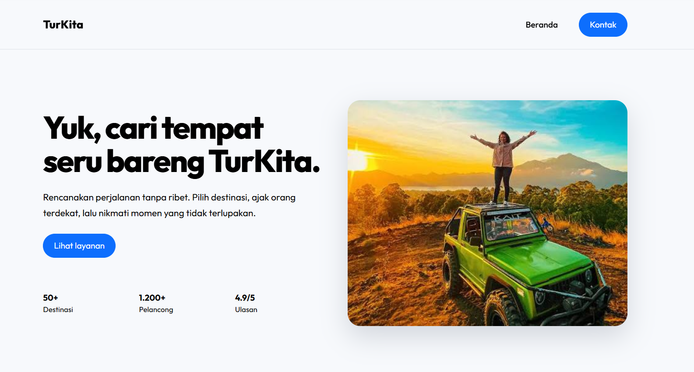

# TurKita

Landing page sederhana untuk layanan perjalanan dan tur wisata menggunakan
Bootstrap dan Tailwind CSS.

## Tampilan



## Struktur Folder

```text
├── bootstrap-version/
│   └── index.html
├── tailwind-version/
│   └── index.html
├── output.png
└── README.md
```

## Penjelasan Program

### Bootstrap

File `bootstrap-version/index.html` membuat landing page menggunakan Bootstrap
5.3.3 melalui CDN. Layout menggunakan sistem grid Bootstrap seperti
`container`, `row`, dan `col`. Halaman juga memiliki navbar, hero section,
kartu layanan, bagian kontak, dan footer.

### Tailwind CSS

File `tailwind-version/index.html` membuat landing page menggunakan Tailwind
CSS melalui Play CDN. Tampilan diatur menggunakan utility class seperti
`flex`, `grid`, `px`, `py`, `text`, dan `rounded`. Struktur halaman sama dengan
versi Bootstrap, tetapi pendekatan styling-nya menggunakan class Tailwind.

## Komponen Halaman

- Navbar TurKita
- Hero section dengan judul, deskripsi, tombol, statistik, dan gambar wisata
- Tiga kartu layanan
- Call-to-action dan informasi kontak
- Footer

Kedua halaman menggunakan resource eksternal berupa CDN Bootstrap atau
Tailwind CSS, Google Fonts, dan gambar wisata.
