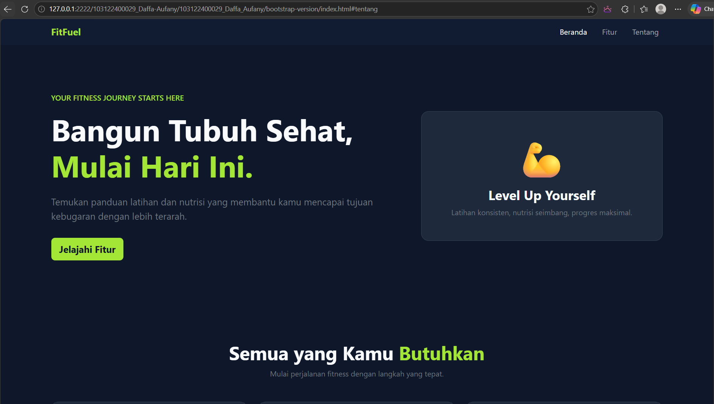
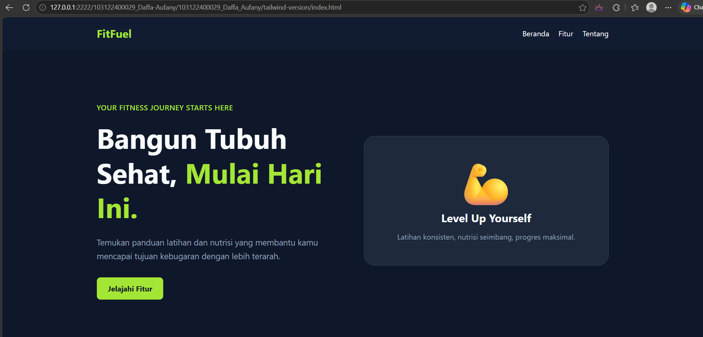

# Week 4 - Bootstrap & Tailwind CSS
**Nama:** Daffa Aufany Febrianto

**NIM:** 103122400029

**Tugas:** Week 4 - Bootstrap & Tailwind CSS
## Deskripsi

Repository ini berisi pengerjaan tugas Week 4, yaitu implementasi landing page sederhana menggunakan dua framework CSS, **Bootstrap** dan **Tailwind CSS**.

Landing page yang dibuat bertema **FitFuel**, sebuah konsep layanan fitness dan nutrisi yang membantu pengguna memahami program latihan, panduan nutrisi, dan pemantauan progres kebugaran.

Kedua versi memiliki konten dan struktur yang relatif sama untuk membandingkan cara penggunaan Bootstrap dan Tailwind CSS dalam membangun antarmuka website yang responsif.

## Teknologi yang Digunakan

- HTML5
- Bootstrap 5.3.3
- Tailwind CSS 4
- CSS
- CDN untuk memuat framework CSS

## Fitur Landing Page

Kedua versi landing page memiliki komponen berikut:

1. **Navbar** — Navigasi menuju bagian Beranda, Fitur, dan Tentang.
2. **Hero Section** — Menampilkan judul utama, deskripsi singkat, dan tombol Call to Action (CTA).
3. **Feature Section** — Menampilkan tiga fitur utama:
   - Program Latihan
   - Panduan Nutrisi
   - Pantau Progres
4. **About Section** — Ajakan untuk memulai perjalanan kebugaran.
5. **Footer** — Menampilkan nama brand dan informasi hak cipta.

## Output / Hasil Implementasi

Berikut merupakan dokumentasi hasil implementasi landing page menggunakan Bootstrap dan Tailwind CSS.

### 1. Bootstrap Version

Screenshot landing page menggunakan Bootstrap.

**File screenshot:** `ss/bootstrap.png`

### 2. Tailwind CSS Version

Screenshot landing page menggunakan Tailwind CSS.

**File screenshot:** `ss/tailwind.png`

## Perbedaan Implementasi

### Bootstrap Version

Menggunakan Bootstrap 5.3.3 untuk membantu membangun layout dan komponen responsif melalui class seperti `container`, `row`, `col-md-4`, `navbar`, dan `btn`. CSS tambahan digunakan untuk menyesuaikan warna dan tampilan.

### Tailwind Version

Menggunakan Tailwind CSS 4 dengan pendekatan utility-first. Styling diterapkan langsung melalui class seperti `grid`, `px-6`, `py-16`, `text-lime`, dan `rounded-lg`.

---
